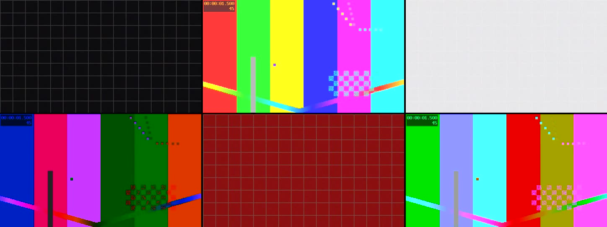

# aivideo-shotkit

**简体中文** · [English](./README.en.md)

> **把一段 AI 生成的视频（或录屏）自动切成「能直接投喂人物替换工具」的片段。**
> 自动识别并裁掉播放器 UI 覆盖层 → 按场景分镜 → 逐镜头量运动量 → 超长镜头再切子段 → 导出带提示词和拼接方案的工作流包。

[](LICENSE)
[](https://github.com/loubaji083-rgb/dsh-plugin-aivideo-shotkit/actions/workflows/ci.yml)
[](package.json)
[](#依赖)
[](https://github.com/deepseek-ai)

---

## 目录

- [它解决什么问题](#它解决什么问题)
- [它不做什么](#它不做什么)
- [特性](#特性)
- [安装](#安装)
- [快速开始](#快速开始)
- [输出物](#输出物)
- [命令与工具参考](#命令与工具参考)
- [工作原理](#工作原理)
- [参数背后的数字（都有出处）](#参数背后的数字都有出处)
- [能力边界](#能力边界)
- [许可红线](#许可红线)
- [常见问题](#常见问题)
- [开发与测试](#开发与测试)
- [贡献](#贡献)
- [许可](#许可)

---

## 它解决什么问题

几乎所有人物替换 / 换脸 / 动作迁移模型都是**单次调用、单个镜头**的工具，而且窗口很窄：

- ComfyUI 的 `WanAnimate2ToVideo` 默认一次只吃 **81 帧 @16fps ≈ 5.06 秒**；
- Kling 3.0 系单次 **3–15 秒**，Runway Act-Two **3–30 秒**，Viggle **5–15 秒**；
- Runway 官方还明确要求 **"No cuts that interrupt the shot"**（一个片段里不能有剪切）。

于是一段几十秒的成片**没法直接喂进去**——你必须先把它切成镜头，再把过长的镜头切成子段，还得让相邻子段之间有重叠好拼回去。

这个工具做的就是这套前处理。它把「靠眼睛看 + 手动 ffmpeg 切」变成一条可重复的命令，并且把**每个片段的推荐工具、参数、提示词、拼接点**一起写进一个工作流包。

它最初是为了处理**录屏素材**而写的：很多 AI 视频是从播放器上录下来的，画面底部压着进度条和弹幕框，直接拿去换脸的话模型会把控件当成画面内容去建模。所以第一步就是自动检测并裁掉那条覆盖层。

## 它不做什么

先把丑话说前面，免得你装完才发现不符合预期：

- **它没有人脸检测器。** 不判断画面里有没有人、脸可不可见、是不是近景。运行环境只要 Node + ffmpeg，不下载任何模型。
- **它不替你做人物替换。** 它只产出「可以拿去替换的片段」和配套说明，替换本身由 Wan Animate / VACE / Kling / LivePortrait 等工具完成。
- **它不自动认人。** 不做人脸识别、不区分角色。
- **它的「暖色/肤色占比」只是画面统计启发式**，暖光室内会偏高，**不能当作"有没有人"的判断依据**，只能用于相对排序。

## 特性

| 能力 | 说明 |
| --- | --- |
| **自动裁掉播放器 UI** | 逐行时序统计找出「暗 + 逐帧静止」的条带，识别 OBS/录屏来源，给出裁切建议。实测在一份 2560×1440 的 bilibili 录屏上准确检出底部 80px 控件条。 |
| **抗闪烁的分镜** | 不直接用 `select='gt(scene,TH)'`（那样在高动态素材上会把闪烁切成一堆假镜头），而是取全片 scene 分数序列后用「孤立尖峰」判据 + 最短镜头时长聚类。 |
| **逐镜头运动量** | 单位统一成**每个模型帧（1/16 秒）的平均亮度差**，因此不同源帧率的素材可以直接比。附运动覆盖率、闪烁、清晰度、亮度等指标。 |
| **按运动量分组** | 静止 / 轻微 / 中等 / 剧烈 四档，每档给出对应的工作流策略与推荐工具。 |
| **超长镜头子分段** | 按工具的单次窗口预设（15s / 5s / 2s）等分并留重叠，输出 `shot_005_seg02_….mp4`。 |
| **工作流包** | 一次产出 `workflow.json` / `prompts.csv` / `README.md` / `analysis.json` / `clips.json`，含逐片段提示词与拼回整片的命令。 |
| **三种用法** | DSH 插件（4 个原生工具 + 技能 + 状态面板）、独立 CLI、或直接 `import` 核心模块。 |
| **零运行时依赖** | 核心只用 Node 内置模块（`spawn` + typed array），不装 numpy / opencv / onnxruntime。 |
| **不需要 ffprobe** | 元数据从 `ffmpeg -i` 的 banner 解析，因此只有一个 ffmpeg 也能跑。 |

## 安装

### 前置：ffmpeg

必须有一个**能被调用到的 ffmpeg**（不要求 ffprobe）。探测顺序：

1. 插件配置 / 参数里的 `ffmpegPath`
2. 环境变量 `AIVIDEO_FFMPEG`、`FFMPEG_PATH`
3. 系统 `PATH`
4. 常见安装位置（Windows：`%LOCALAPPDATA%\oopz\ffmpeg.exe`、`%APPDATA%\bilibili\ffmpeg\ffmpeg.exe` 等）

```bash
ffmpeg -version        # 确认可用即可
```

> 建议用 **4.x 以上**的构建。开发时也在 ffmpeg 3.0.1（2016 年构建）上验证过核心路径可用，但老构建缺 `scdet` 等滤镜，且没有 NVENC。

### 方式一：装进 DSH（推荐，得到工具 + 技能 + 面板）

```bash
# 从 GitHub 安装（包名即目录名）
dsh plugin --profile <你的 profile> add github:loubaji083-rgb/dsh-plugin-aivideo-shotkit

# 或者从本地克隆安装
git clone https://github.com/loubaji083-rgb/dsh-plugin-aivideo-shotkit.git
dsh plugin --profile <你的 profile> add file:/绝对路径/dsh-plugin-aivideo-shotkit
```

也可以直接在 DSH 的图形插件管理器里安装。**装完需要让 profile 重新加载（重启 DSH）**，因为 profile 的 bundle 列表是开机时组合的。

装好后会得到：

- 4 个原生工具：`aivideo_probe` / `aivideo_detect_shots` / `aivideo_analyze` / `aivideo_split`
- 1 个技能 `aivideo-shotkit`（模型会在你提到视频切分/人物替换时自动用上）
- 1 个只读状态面板：「设置 → AI 视频切片」，显示最近一次分析/切割的摘要
- 1 个只读路由 `GET /aivideo-shotkit/state`

### 方式二：只用 CLI（不装 DSH）

```bash
git clone https://github.com/loubaji083-rgb/dsh-plugin-aivideo-shotkit.git
cd dsh-plugin-aivideo-shotkit
node bin/shotkit.mjs run "<你的视频>" --out ./out --filmstrip
```

CLI 不需要安装任何依赖，也不需要 DSH。

### 方式三：当库用

```js
import { analyzeVideo, exportShots, resolveToolchain } from './lib/core/pipeline.mjs';

const tc = resolveToolchain();
const analysis = await analyzeVideo(tc.ffmpeg, 'input.mp4', { outputDir: './out' });
const result = await exportShots(tc.ffmpeg, 'input.mp4', analysis, { outputDir: './out' });
```

## 快速开始

### 0. 先跑一遍合成演示（30 秒，不碰你的素材）

仓库里带了一个**完全合成**的演示素材生成器——它现造一段带「假播放器控件条」的视频，正好用来验证整条流水线：

```bash
node scripts/make-demo-video.mjs --out demo/demo.mp4
node bin/shotkit.mjs run demo/demo.mp4 --out demo/out --filmstrip
```

预期结果（实测）：

```
video 640x388 -> crop {"x":0,"y":0,"width":640,"height":358}  playerUi true  chromeBottomPx 30
scene.max 1   shots 6
  #1 0->3  motion 0.00 static  local  cat still   score 0.61
  #2 3->6  motion 3.91 moderate mixed cat subtle  score 0.86
  #3 6->9  motion 0.00 static  local  cat still   score 0.52
  #4 9->12 motion 2.36 low     mixed cat subtle  score 0.81
  #5 12->15 motion 0.00 static local  cat still   score 0.61
  #6 15->18 motion 3.23 moderate mixed cat subtle score 0.85
```

6 个场景全部命中在精确的 3.000 / 6.000 / 9.000 / 12.000 / 15.000 秒切点上，底部控件条被自动裁掉。



### 1. 处理你自己的素材

**在 DSH 里**（模型会自动按顺序调用）：

```
先用 aivideo_probe 看看这段视频有没有播放器 UI 覆盖层
再用 aivideo_analyze 分镜并评估
确认后 aivideo_split 切割并生成工作流包
```

**在命令行**（一条命令跑完全流程）：

```bash
node bin/shotkit.mjs run "<视频路径>" --out ./out --filmstrip
```

`run` = `analyze` + `cut`。产物见下一节。

### 2. 按需调整

```bash
# 本地开源管线（ComfyUI / VACE），单段上限收到 5s
node bin/shotkit.mjs run "<视频>" --segment-preset opensource

# 无损切割（快，但切点会吸附到最近关键帧）
node bin/shotkit.mjs run "<视频>" --mode copy --no-segment

# 只处理前 5 个镜头，不要缩略图
node bin/shotkit.mjs run "<视频>" --only 1,2,3,4,5

# 素材已经裁好了，别动画幅
node bin/shotkit.mjs run "<视频>" --no-crop
```

## 输出物

`--out <目录>` 下会得到：

```
out/
├── shot_001_00h00m00s000-00h00m02s183.mp4      每个镜头一个片段
├── shot_005_seg01_00h00m09s133-00h00m12s133.mp4 超长镜头的子段（带重叠）
├── shot_005_seg02_00h00m10s716-00h00m13s716.mp4
├── ...
├── filmstrip.jpg                                分镜缩略图拼版（--filmstrip）
├── .frames/f001.jpg … f020.jpg                  每个镜头的抽帧
├── workflow.json                                完整机器可读的工作流方案
├── prompts.csv                                  逐子段的提示词表（Excel 可开）
├── analysis.json                                逐帧统计与逐镜头指标原始数据
├── clips.json                                   切割清单
└── README.md                                    给人看的工作流说明（含拼接命令）
```

`README.md` 是其中最有用的一个，包含：

- 概览：切出多少镜头、多少可投喂片段、平均镜头长度
- 每个分组用哪个窗口、推荐哪些工具
- 逐镜头清单：起止 / 时长 / 分段数 / 分组 / 运动分布 / 判定 / 可替换性 / 运动量 / 运动覆盖
- 长镜头的子分段表：每段文件、重叠时长、**建议拼接点**
- 「拼回整片」的 5 步操作和可复制的 ffmpeg 命令

## 命令与工具参考

### CLI

```bash
node bin/shotkit.mjs <命令> [选项]
```

| 命令 | 作用 |
| --- | --- |
| `probe <视频>` | 只探测元数据与画面覆盖层，不写文件 |
| `shots <视频>` | 只做分镜检测，返回镜头列表和切点分数 |
| `analyze <视频>` | 分镜 + 逐镜头评估 + 分组 |
| `cut <视频>` | 只切割（可复用之前的分析结果） |
| `run <视频>` | `analyze` + `cut`，一条命令跑完 |

常用选项：

```
--out DIR            输出目录
--filmstrip          生成分镜缩略图拼版（analysis 命令）
--json               以 JSON 输出（probe/shots/analyze）
--min-shot SEC       最短镜头时长，默认 1.5
--min-score N        场景分数阈值，默认 0.3
--only LIST          只导出指定镜头号，如 1,3,5
--min-verdict V      只导出评分不低于 V 的镜头：excellent|good|fair
--no-crop            不裁掉播放器 UI 覆盖层
--crop-bottom N      手动指定底部裁掉像素数
--segment            把超长镜头再切成可投喂的子片段（默认开启）
--no-segment         关闭子分段：一个镜头一个文件
--segment-preset P   cloud(默认,≤15s) | opensource(≤5s) | tight(≤2s)
--max-segment N      自定义单段上限秒数（覆盖 preset）
--min-segment N      自定义最短段秒数（默认取 preset）
--overlap N          自定义段间重叠秒数（默认取 preset）
--mode MODE          reencode（默认，帧精确）| copy（无损，切点吸附关键帧）
--quality Q          high | balanced（默认）| fast | lossless
```

### DSH 工具

#### `aivideo_probe`

探测视频的编码/分辨率/帧率/时长/音轨，并检测播放器 UI 覆盖层或黑边，给出建议裁切区域。**在对录屏素材做任何切割之前先调用它。**

| 参数 | 类型 | 说明 |
| --- | --- | --- |
| `video` | string **必填** | 视频文件绝对路径 |
| `ffmpegPath` | string | 可选，留空自动探测 |

#### `aivideo_detect_shots`

只做分镜，返回镜头列表与切点分数，不做评估、不写文件。

| 参数 | 类型 | 说明 |
| --- | --- | --- |
| `video` | string **必填** | 视频文件绝对路径 |
| `ffmpegPath` | string | 可选 |
| `minShotSeconds` | number | 最短镜头时长，默认 1.5 |
| `minScore` | number | 场景分数阈值，默认 0.3 |
| `cropBottom` | number | 手动指定底部裁掉像素数 |
| `keepFullFrame` | boolean | 为 true 时完全不裁切 |

#### `aivideo_analyze`

分镜 + 逐镜头评估 + 分组。可选输出 `filmstrip.jpg`。

参数在 `aivideo_detect_shots` 的基础上增加：

| 参数 | 类型 | 说明 |
| --- | --- | --- |
| `segmentPreset` | string | 子分段窗口预设 |
| `maxSegmentSec` | number | 自定义单段上限（覆盖 preset） |
| `overlapSec` | number | 自定义段间重叠（覆盖 preset） |
| `outputDir` | string | 写缩略图的目录；不填则不出缩略图 |

#### `aivideo_split`

切割视频并生成工作流包。**这是唯一会写文件的一步。**

参数在 `aivideo_analyze` 的基础上增加：

| 参数 | 类型 | 说明 |
| --- | --- | --- |
| `outputDir` | string | 输出目录；不填则用「视频同目录/`<文件名>-shotkit-<时间戳>`」 |
| `mode` | string | `reencode`（默认）或 `copy` |
| `quality` | string | `high` / `balanced` / `fast` / `lossless` |
| `only` | string | 只导出指定镜头号，如 `"1,3,5"` |
| `minVerdict` | string | 只导出评分不低于该档：`excellent` / `good` / `fair` |
| `segment` | boolean | 默认 true |
| `noBundle` | boolean | 只切片段，不生成文档 |

#### 插件配置项

| 键 | 默认 | 说明 |
| --- | --- | --- |
| `ffmpegPath` | `''` | 留空自动探测 |
| `minShotSeconds` | `1.5` | 最短镜头时长 |
| `minScore` | `0.3` | 场景分数阈值 |
| `cropBottomPx` | `0` | 强制每次裁掉底部这么多像素 |
| `sampleTargetFrames` | `1800` | 逐帧分析的目标抽样帧数 |
| `autoSides` | `false` | 是否也自动裁左右（默认关，避免误伤画面） |
| `registerTools` | `true` | 是否注册 4 个工具 |
| `registerSkill` | `true` | 是否注册技能 |

## 工作原理

```
视频 ──▶ ①探测/裁切 ──▶ ②逐帧统计 ──▶ ③分镜 ──▶ ④逐镜头评估 ──▶ ⑤子分段 ──▶ ⑥导出
         probe          scene 分数序列   聚类      指标+分组        planSegments   工作流包
```

**① 探测与自动裁切。** 按固定帧率把全片降采样成 160×90 的灰度帧，逐行统计「是否几乎逐帧不变」和「是否很暗」。底部/顶部那些"又暗又静止"的连续行就是播放器控件条（它不是黑边，是叠在全画幅上的覆盖层，`cropdetect` 抓不到）。检出后按帧高换算成像素，**向外多扩一行**吸收抗锯齿过渡。

**② 逐帧统计。** 对每个采样帧计算亮度、对比度、清晰度（拉普拉斯方差）、饱和度、暖色像素占比，以及**与前一个采样帧的逐像素亮度差**。运动量按模型帧（1/16 秒）归一化。

**③ 分镜。** 取全片 scene 分数序列，用「孤立尖峰」判据挑切点——真切点的特征是**单帧尖峰后立刻回落**，而高速运动造成的是**连续多帧高位**。再用最短镜头时长把挨得太近的切点合并，只保留变化更剧烈的那个。

**④ 逐镜头评估。** 汇总运动量、运动覆盖率（画面里有多大比例在动）、闪烁率、清晰度、曝光、时长，加权成「可替换性」评分与判定，并映射到四个工作流分组。

**⑤ 子分段。** 镜头长于该分组窗口时等分：`段数 = max(2, ceil((时长-重叠)/(窗口-重叠)))`，每段恰好窗口长，首段锚 0、末段锚结尾，相邻段重叠固定秒数（重叠会随段数略微放大，实际值写在 `segments[].overlapWithPrev`）。

**⑥ 导出。** 逐段切割（`reencode` 帧精确；`copy` 无损但切点吸附关键帧），写出片段与工作流包。

## 参数背后的数字（都有出处）

### 子分段窗口预设

| 预设 | 单段上限 | 最短段 | 重叠 | 适用 |
| --- | --- | --- | --- | --- |
| `cloud`（默认） | 15s | 3s | 1.0s | Wan Animate API / Kling / Viggle / Runway |
| `opensource` | 5s | 2s | 1.0s | ComfyUI `WanAnimate2ToVideo` / VACE |
| `tight` | 2s | 1s | 0.5s | 身份漂移严重时的保守设置 |

### 各工具的单次窗口（选择窗口的依据）

| 工具 | 单次窗口 | 出处 |
| --- | --- | --- |
| Wan2.2 Animate API | 参考视频 **2–30s**，宽高 200–2048px | [阿里云百炼文档](https://www.alibabacloud.com/help/en/model-studio/wan-animate-move-api) |
| ComfyUI `WanAnimate2ToVideo` | `length=81` 帧 @16fps ≈ **5.06s** | [ComfyUI 内置节点文档](https://docs.comfy.org/built-in-nodes/WanAnimate2ToVideo) |
| VACE / Wan2.1 | **81 帧** @16fps（1.3B 480×832 / 14B 720×1280） | [ali-vilab/VACE](https://github.com/ali-vilab/VACE) |
| Runway Act-Two | **3–30s，24fps**；官方要求"不得有中断镜头的剪切" | [Runway 帮助中心](https://help.runwayml.com/hc/en-us/articles/42311337895827) |
| Kling | 3.0 系 **3–15s**；O1/2.6 **3–10s**；2.5 Turbo 仅 5s 或 10s | [Kling 能力对照表](https://kling.ai/document-api/guides/capability-map/video.md) |
| Viggle | 驱动视频 **5–15s** | [Viggle 定价文档](https://docs.viggle.ai/v1/pricing) |
| LivePortrait | 驱动视频裁成 **1:1**（512×512 或 256×256） | [KwaiVGI/LivePortrait](https://github.com/KwaiVGI/LivePortrait) |
| MimicMotion | 72 帧 @576×1024 | [Tencent/MimicMotion](https://github.com/Tencent/MimicMotion) |
| UniAnimate | 32 帧，`context_overlap` 默认 8、漂移时建议 16 | [ali-vilab/UniAnimate](https://github.com/ali-vilab/UniAnimate) |

### 运动量分档

单位是**每个模型帧（1/16 秒）的平均亮度差**（0–255 灰度）。用模型帧而不是源帧做分母，是为了让 24fps / 30fps / 60fps 的素材可以互相比较。

| 分档 | 阈值 | 建议策略 |
| --- | --- | --- |
| 静止 | `< 1` | 取帧 → 换角色 → 重新生成运动（两步法，成功率最高） |
| 轻微运动 | `1 – 4` | 换脸首选（LivePortrait / LatentSync） |
| 中等运动 | `4 – 12` | 动作迁移（Wan Animate / VACE） |
| 剧烈运动 | `≥ 12` | 先切短到 1–2s，做光流稳定化再迁移 |

### 拼接规则

重叠区间的两个端点恰好是两侧输出一致性最弱的时刻，所以**在重叠中点切换**；`xfade` 用 1.0s（ffmpeg 默认值）；拼接前必须把各段统一到相同分辨率/像素格式/帧率/timebase；用 concat 滤镜时**必须显式写 `a=1`** 才会带音轨。

## 能力边界

这一节是刻意写详细的。工具的价值取决于你能不能信任它的输出，所以这里把不成立的事情也写清楚。

| 项 | 实际情况 |
| --- | --- |
| 人脸检测 | **没有**。想判断"脸可不可见"请自己接 YuNet（MIT，可商用）或其它检测器。 |
| 镜头尺度 | **测不出**。曾经用运动覆盖率反推"近景/全身"，在一份真实素材上直接翻车：`#10` 是近景却算成 9%、`#11` 是远景全身却算成 23%。这个字段已经删掉，改成中性的「整幅/部分/局部运动」。尺度请对着 `filmstrip.jpg` 目视确认。 |
| 暖色/肤色占比 | 只是画面统计启发式，暖光室内会整体偏高。**只能用于相对排序。** |
| 裁切精度 | 条带检测在 160×90 的网格上做，精度约 ±1 个网格行（≈ 帧高的 1/90）。在 1440p 素材上是 ±16px；需要精确值时用 `--crop-bottom` 手动指定。 |
| 运动量不变性 | 基于亮度差，因此淡入淡出、闪白、剧烈打光变化会被读成"运动"。 |
| 硬切以外的转场 | 溶解/擦除会被归到某一侧，可能让镜头边界偏移若干帧。 |
| `--mode copy` | ffmpeg 的 `-c copy` 切点会吸附到最近关键帧，**不帧精确**，镜头起止可能差几秒（取决于 GOP 长度）。需要精确就用 `--mode reencode`（默认）。 |

**一次真实素材上的表现**（2560×1440 @60fps，OBS 录制的 bilibili 播放器画面，61 秒）：

```
自动裁切    2560x1440 → 2560x1360+0+0（检出底部 80px 控件条）
分镜        20 个镜头，平均 3.054s，中位 2.85s
子分段      31 个可投喂片段（9 个镜头因超长被切分）
评估        16 个判定为可直接用于替换
```

原始 `select='gt(scene,0.25)'` 在同一段素材上一次命中 **263 个**时间点（25.0–28.4s 区间就挤了约 50 个）——这就是为什么必须做聚类后处理。

## 许可红线

**本仓库的代码是 MIT 的，但它推荐的一部分模型不是。** 涉及商用请务必读这一节。

✅ **可商用**

- VACE / Wan2.1 —— Apache-2.0
- LivePortrait —— MIT
- Champ —— MIT
- YuNet（人脸检测，OpenCV Zoo）—— MIT，且能检出 10×10 到 300×300 的人脸

⛔ **仅限非商用研究**

- `insightface` / `buffalo_l` / `inswapper_128.onnx` / `inswapper_128_fp16.onnx` / `codeformer-v0.1.0.pth`
- 自 **2025-11-24** 起，官方要求商用联系授权：`recognition-oss-pack@insightface.ai`
- 注意 SCRFD 的**代码**是 MIT，但用的**权重**（DWPose / buffalo_l 训练数据）标注为 "available for non-commercial research purposes only"，所以权重同样不能商用

⚠️ **另外**：涉及**真人**肖像时，无论用什么模型，都请确认已获得当事人授权；很多云服务的服务条款也明确要求这一点。本工具只做技术前处理，不提供任何法律意见。

## 常见问题

**Q：报错 `not a decodable video` / 找不到 ffmpeg？**
先跑 `node bin/shotkit.mjs probe "<你的视频>"` 看探测结果。找不到 ffmpeg 时用 `--ffmpeg-path` 或设环境变量 `AIVIDEO_FFMPEG` 指向可执行文件。

**Q：镜头切得太碎 / 太少？**
调 `--min-score`（默认 0.3）。调低切更多，调高合并更多。同时看 `--min-shot`（默认 1.5 秒）——挨得太近的切点会按分数保留一个。

**Q：为什么片段数比镜头数多？**
因为超长镜头被子分段了。想要一个镜头一个文件就加 `--no-segment`。

**Q：裁切把画面内容切掉了一点？**
条带检测有 ±1 个网格行的量化误差。用 `--crop-bottom N` 精确指定，或者 `--no-crop` 完全不裁。

**Q：`--mode copy` 切出来的片段时长对不上？**
`copy` 不帧精确，切点会吸附到最近关键帧。换 `--mode reencode`。

**Q：能处理多长的视频？**
分镜与评估是逐帧统计，默认抽样到约 1800 帧，所以长视频不会线性变慢；但切割时长与片段数成正比。几十分钟的片子建议先用 `--only` 试切几个镜头。

**Q：支持哪些格式？**
任何 ffmpeg 能解码的（mp4 / mov / mkv / webm / avi …）。输出统一为 mp4（H.264 + AAC）。

**Q：装进 DSH 之后没看到工具？**
profile 的 bundle 列表是**开机时**组合的，装完要重启 DSH。也可以在 DSH 的插件管理器里确认它处于启用状态。

## 开发与测试

```bash
# 1) 语法检查（全部源码）
node --check lib/index.js

# 2) 探测端到端自检
node scripts/smoke-probe.mjs "<任意视频>"

# 3) 宿主契约测试 —— 用假 Cordis ctx 跑真实的 lib/index.js
node scripts/host-load-test.mjs

# 4) 全流程合成素材自测（不需要任何真实素材）
node scripts/make-demo-video.mjs --out demo/demo.mp4
node bin/shotkit.mjs run demo/demo.mp4 --out demo/out --filmstrip
```

第 3 项值得单独说明：`scripts/host-load-test.mjs` 会构造一个假的 Cordis `ctx`，然后加载**真实的** `lib/index.js`，并调用**真实的** `defineTool()`。它能抓到只在宿主里才暴露的契约问题——例如「在 `output.schema` 里写 `required` 会在定义期抛错」这类 CLI 测不出来、而"装进 profile 再重启"的反馈回路又太慢的问题。当前 51 项断言全绿。

`scripts/` 下还有几个诊断脚本：`dump-rowstats.mjs`（逐行/逐列时序统计，用于分析覆盖层）、`dump-scenes.mjs`（导出逐帧 scene 分数）、`motion-diag.mjs`（判断运动是真实相干运动还是噪声/闪烁）。

## 贡献

欢迎 issue 和 PR。请先读 [CONTRIBUTING.md](CONTRIBUTING.md)，里面写了这个项目最看重的两条：**零运行时依赖**，以及**不夸大能力**。

## 许可

[MIT](LICENSE) © 2026 loubaji083-rgb

本仓库代码可自由使用、修改、分发；但它推荐/对接的第三方模型另有许可，见上面的[许可红线](#许可红线)。
